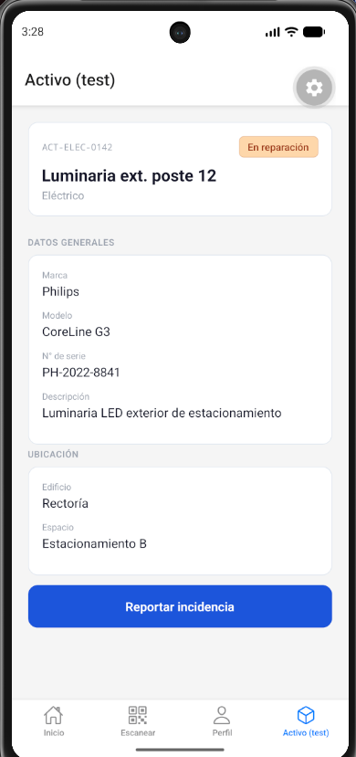
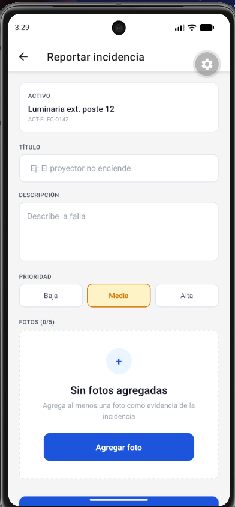
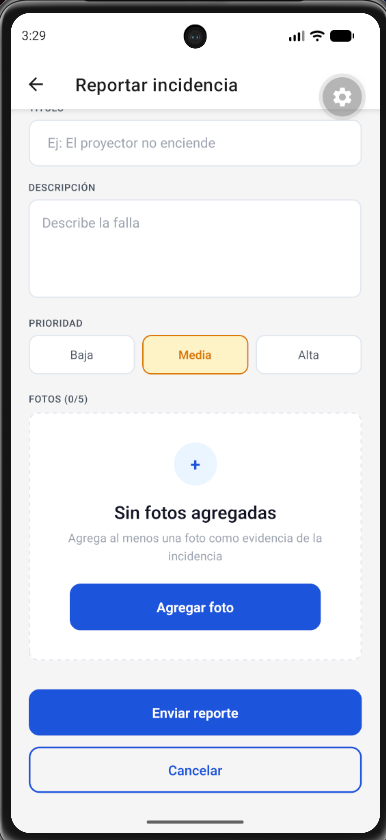
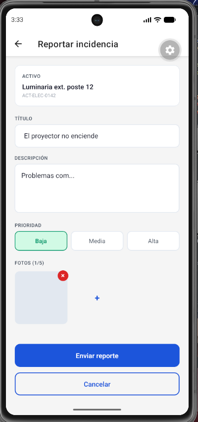
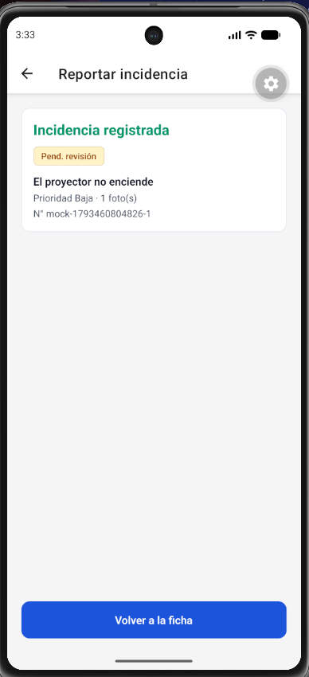

# Evidencia RNF5 — Usabilidad táctil con una sola mano (Sprint 2)

**Responsable:** Débora Vizama
**Fecha:** 31-10-2026
**Dispositivo de prueba:** Emulador Android (Pixel 7, API 37.1)

## Qué se probó

Se verificó que los elementos interactivos del flujo de reporte de incidencia
(ficha del activo → formulario → confirmación) estén ubicados dentro de la
zona de alcance del pulgar, sin requerir la segunda mano, y que los touch
targets cumplan el mínimo de 44px, continuando el estándar fijado en la
evidencia RNF5 de Sprint 1.

## Checklist

| Elemento | Ubicación | Alcanzable con una mano | Touch target |
|---|---|---|---|
| Botón "Reportar incidencia" (ficha del activo) | Tercio inferior | Sí | 52px |
| Campo TÍTULO | Centro-superior | Sí | — |
| Campo DESCRIPCIÓN | Centro | Sí | — |
| Chips de PRIORIDAD (Baja/Media/Alta) | Centro | Sí | 44px |
| Botón "Agregar foto" (estado vacío) | Centro-inferior | Sí | 52px |
| Botón "+" para agregar más fotos (con fotos ya agregadas) | Dentro del grid | Sí | 44px (celda completa) |
| Botón "×" para quitar foto | Esquina de cada miniatura | Sí | 24px visual, ~44px de área táctil real (hitSlop +10px por lado) |
| Botón "Enviar reporte" | Tercio inferior | Sí | 52px |
| Botón "Cancelar" | Tercio inferior, bajo "Enviar reporte" | Sí | 52px |
| Botón "Volver a la ficha" (confirmación) | Tercio inferior | Sí | 52px |

## Flujo probado

1. Ficha del activo (`AssetDetailScreen`) → botón "Reportar incidencia".
2. Formulario vacío → se observa el estado vacío de fotos (EmptyState) con
   botón "Agregar foto" y la prioridad "Media" preseleccionada por defecto.
3. Llenado de título, descripción y cambio de prioridad a "Baja" (chip
   verde, confirma el color por prioridad).
4. Agregado de una foto de prueba → aparece en el grid con botón de quitar.
5. Envío del reporte → vista de confirmación "Incidencia registrada" con
   número de incidencia mock y botón "Volver a la ficha".

## Hallazgo y ajuste

El botón "×" para quitar una foto mide 24px de diámetro visualmente, por
debajo del mínimo de 44px. Se verificó en el código (`PhotoPicker.js`) que
tiene `hitSlop={10}` aplicado, lo que extiende el área táctil real a
aproximadamente 44×44px sin necesidad de agrandar el círculo visualmente
(evita que la miniatura se vea recargada). Se considera que cumple el
estándar de RNF5 por área táctil efectiva, aunque no por tamaño visual.

## Evidencia fotográfica

## Conclusión

El flujo de reporte de incidencia cumple con RNF5: los elementos
principales están dentro de la zona de alcance del pulgar, con touch
targets iguales o superiores a 44px (incluyendo el botón de quitar foto,
que alcanza el mínimo mediante área táctil extendida), y la navegación
completa del flujo no requiere el uso de la segunda mano.