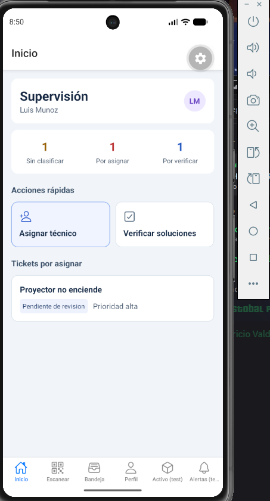
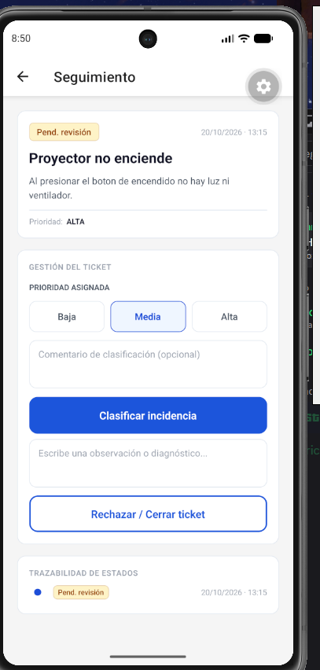
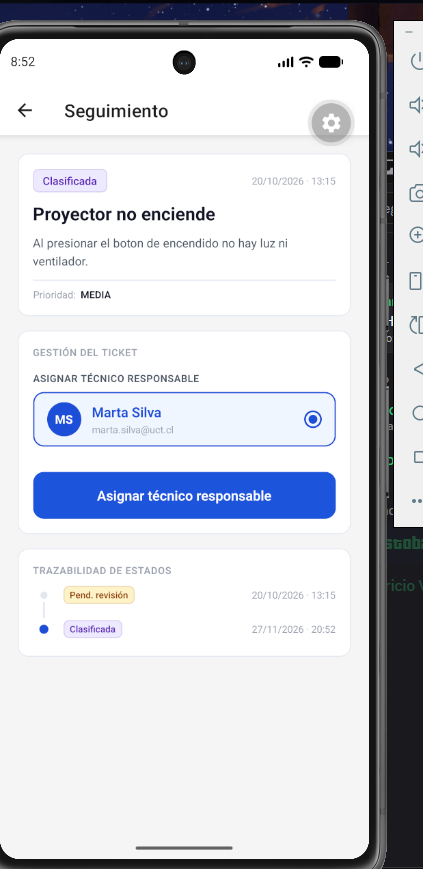
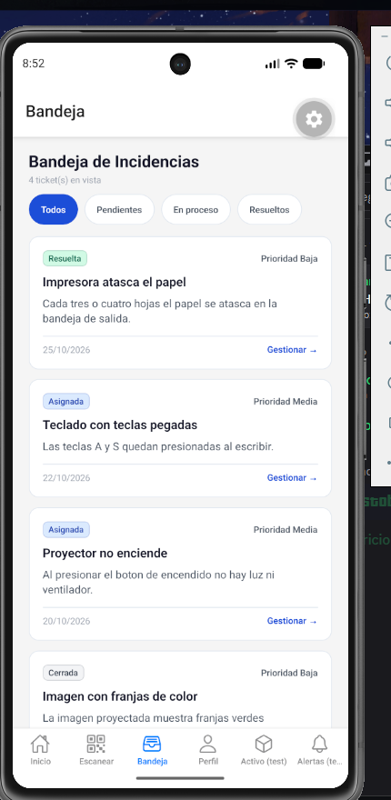
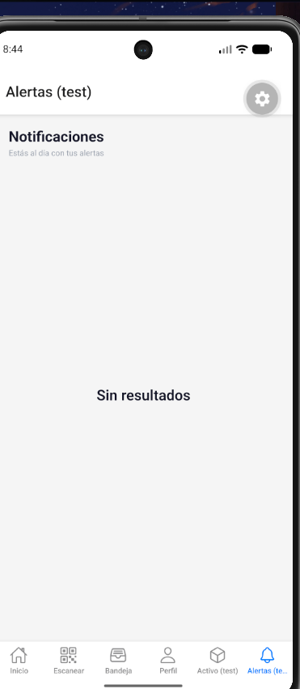

# Evidencia RNF5 — Usabilidad táctil con una sola mano (Sprint 3)

**Responsable:** Débora Vizama
**Fecha:** 27-11-2026
**Dispositivo de prueba:** Emulador Android (Pixel 7, API 37.1)

## Qué se probó

Se verificó que los elementos interactivos del flujo de supervisión,
seguimiento de incidencias y notificaciones (`SupervisorInboxScreen`,
`IncidentTrackingScreen` y `NotificationsScreen`) estén ubicados dentro de
la zona de alcance del pulgar, sin requerir el uso de la segunda mano, y
que sus áreas táctiles cumplan el mínimo ergonómico de 44px establecido en
RNF5.

## Checklist

| Elemento | Ubicación | Alcanzable con una mano | Touch target |
|---|---|---|---|
| Chips de filtro en bandeja (`Todos`, `Pendientes`, `En proceso`, `Resueltos`) | Tercio superior-medio | Sí | 40px–44px (scroll horizontal fluido) |
| Tarjetas de ticket en `SupervisorInboxScreen` | Centro | Sí | Tarjeta completa (>96px de alto) |
| Botones de selección de prioridad (`Baja`, `Media`, `Alta`) | Centro | Sí | 44px |
| Campo de comentario de clasificación / observación | Centro | Sí | 72px |
| Botón primario `"Clasificar incidencia"` | Centro-inferior | Sí | 52px |
| Botón secundario `"Rechazar / Cerrar ticket"` | Centro-inferior | Sí | 52px |
| Selector de técnico (`TechnicianSelector`) | Centro | Sí | 64px por fila de técnico |
| Botón primario `"Asignar técnico responsable"` | Centro-inferior | Sí | 52px |
| Tarjetas de notificación en `NotificationsScreen` | Centro | Sí | Tarjeta completa (>76px de alto) |
| Barra de navegación inferior (`AppTabs`) | Borde inferior | Sí | 56px |

## Flujo probado

1. Inicio de sesión con perfil **Supervisor** (`luis.munoz@uct.cl`) y visualización del panel de supervisión en **Inicio**.
2. Apertura del ticket `"Proyector no enciende"` en `IncidentTrackingScreen` y clasificación de prioridad seleccionando `"Media"` y pulsando `"Clasificar incidencia"`.
3. Selección de técnico responsable mediante `TechnicianSelector` (`Marta Silva`) y confirmación con `"Asignar técnico responsable"`, actualizando el estado a `Asignada` y registrando el evento en `StatusTimeline`.
4. Verificación en la pestaña **Bandeja** (`SupervisorInboxScreen`) con los filtros superiores y la tarjeta actualizada a `Asignada`.
5. Revisión de `NotificationsScreen` verificando la visualización del componente `EmptyState` cuando no existen alertas pendientes.

## Hallazgo y ajuste

Los chips de filtro horizontal en `SupervisorInboxScreen` tienen una altura visual compacta (~38–40px) para evitar desbordar en pantallas angostas, pero cuentan con espaciado horizontal de 8px entre opciones y están alojados en un `ScrollView` horizontal que responde al deslizamiento natural del pulgar sin activar selecciones accidentales. Los botones de acción críticos (`Clasificar incidencia`, `Asignar técnico responsable` y `Rechazar / Cerrar ticket`) mantienen una altura fija de 52px en la zona central-inferior de alcance cómodo.

## Evidencia fotográfica

## Conclusión

El flujo completo de supervisión, trazabilidad y notificaciones cumple con RNF5: todas las acciones de filtrado, clasificación y asignación se operan cómodamente con una sola mano desde el emulador Android, manteniendo áreas táctiles amplias (44px–52px) y retroalimentación inmediata en la línea de tiempo de estados.